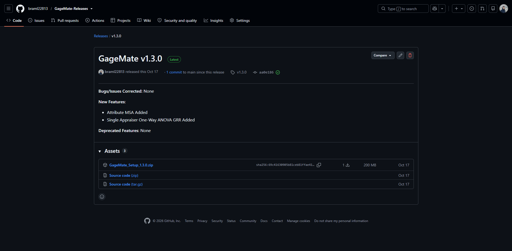
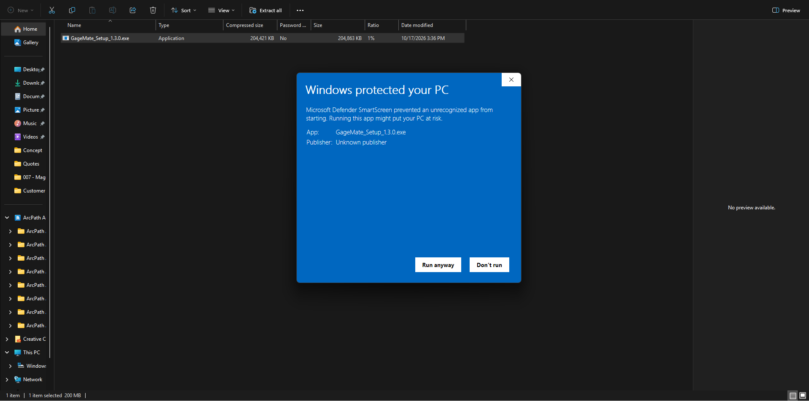
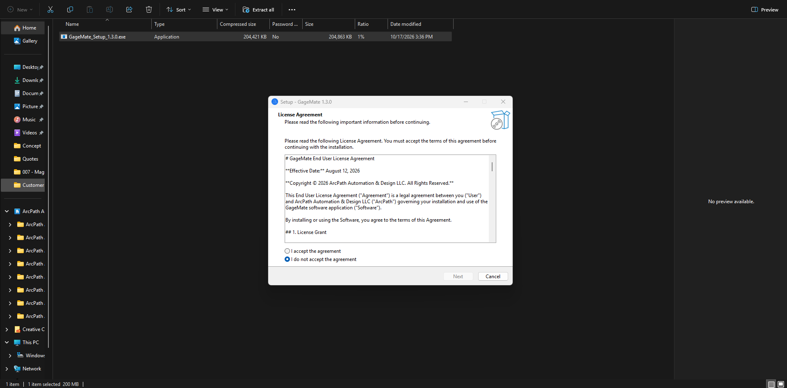
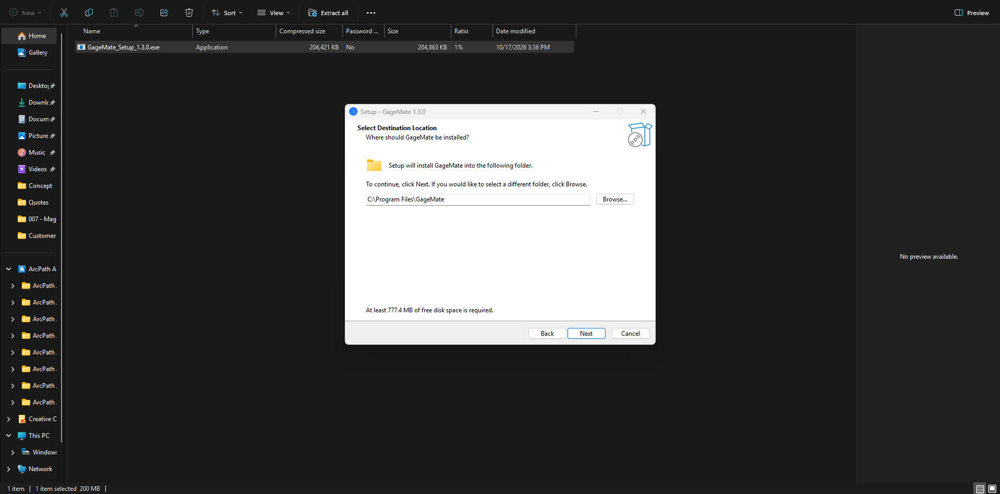
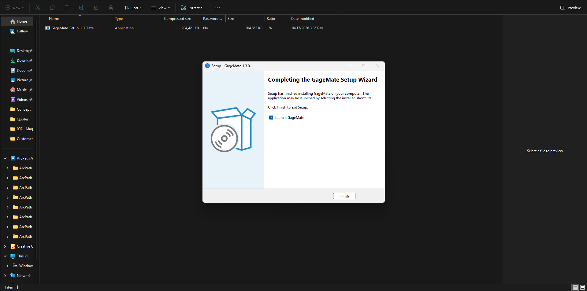
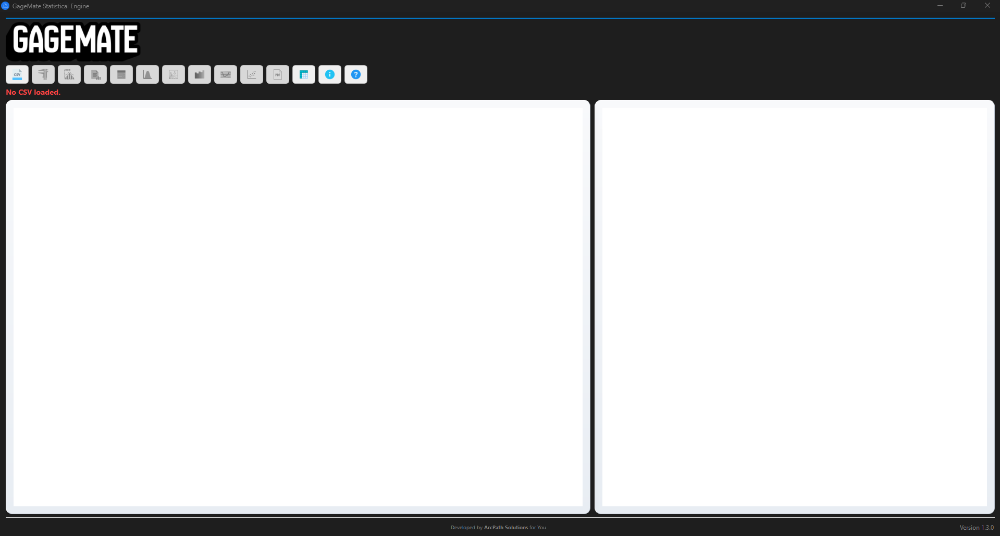

# Download & Installation

This guide covers the GageMate 1.3.0 Windows installer. Use only the official release link provided by the publisher. Confirm the current release filename before publishing this guide.

## 1. Check compatibility

Read [System Requirements](system-requirements.md) and [Corporate IT & Security](corporate-it-security.md) before downloading.

## 2. Download the release installer

1. Open the **official GageMate GitHub Releases page** (add the verified public release URL here).
2. Select the intended version, such as **v1.3.0**.
3. Expand **Assets** and download the Windows setup executable, not the source-code ZIP archives.
4. Save it to a known location, such as Downloads.

{ width="650" align="center" }

## 3. Verify the download

If a SHA-256 checksum is published for the release, compare it with the downloaded file using PowerShell:

```powershell
Get-FileHash -Algorithm SHA256 -Path "C:\Users\YOUR-USER\Downloads\GageMate_Setup_1.3.0.exe"
```

Compare the resulting hash with the value published through the official release channel. A matching checksum confirms file integrity against that reference; it does not by itself prove the publisher's identity.

## 4. Review security warnings

Windows may show a SmartScreen or unrecognized-publisher warning, especially if the installer is unsigned or has limited reputation. Verify the release source and contact IT if you are on a managed computer. **Do not disable security tools or bypass organizational policy.**

{ width="650" align="center" }

## 5. Run the installer

1. Launch the downloaded setup executable if your organization's policy permits it.
2. Read and accept the EULA only if you agree to its terms.
{ width="650" align="center" }
3. Confirm the destination directory and proceed through the Setup wizard.
{ width="650" align="center" }
4. Wait for installation to finish.
{ width="650" align="center" }

## 6. Launch GageMate

Open GageMate from the Windows Start menu or installed shortcut. Confirm the version shown by the application and load a non-sensitive sample CSV to test the interface.

{ width="650" align="center" }

## 7. Need help?

See [Troubleshooting](troubleshooting.md). For corporate systems, request approval from your IT administrator before attempting remediation.
